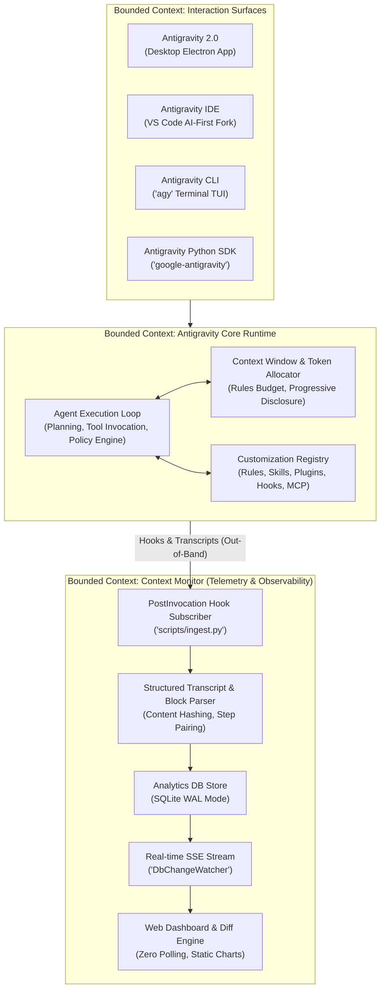
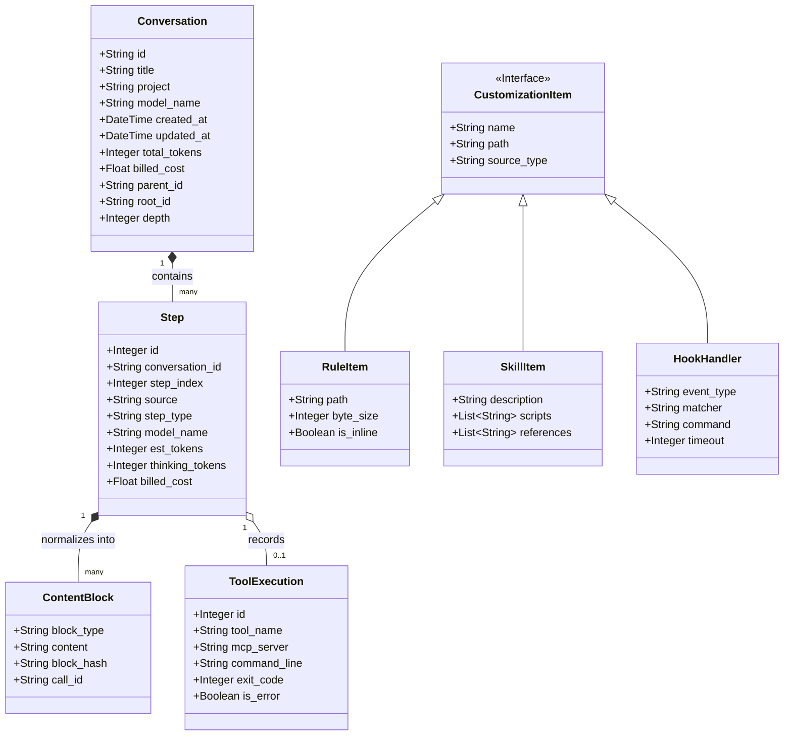
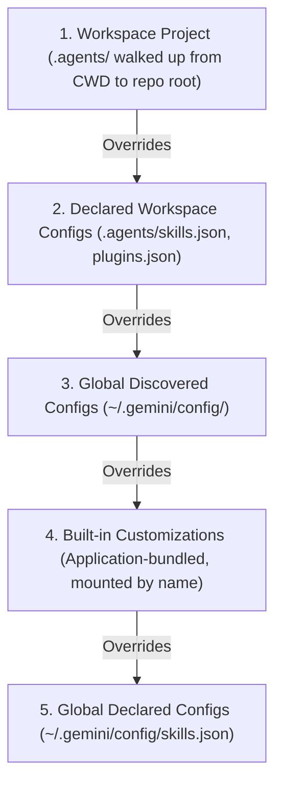
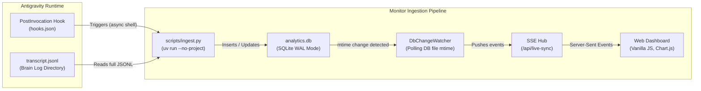

# Google Antigravity & Context Monitor Domain Context (`CONTEXT.md`)

This document defines the authoritative domain model, ubiquitous language, context boundaries, token economics, and runtime contracts for **Google Antigravity (AGY)** and its observability subsystem, **Antigravity Context Monitor (`agy-context-monitor`)**.

---

## 1. Bounded Context & Architecture Overview

The system is organized into three bounded contexts that interact across well-defined interfaces:



### Context Roles & Boundaries

1. **Antigravity Core Runtime**:
   - Manages the agent execution loop, tool sandboxing, security policies, token allocation budgets, and customization resolution.
   - Emits structured execution logs (`transcript.jsonl`) and executes lifecycle hooks (`hooks.json`).
2. **Interaction Surfaces**:
   - Desktop (2.0), IDE, CLI (`agy`), and Python SDK (`google-antigravity`).
   - Expose AI modalities (Passive Autocomplete, Instructive Inline `Cmd+I`, Collaborative Chat & Agent Planning) and capture human intent.
3. **Context Monitor (`agy-context-monitor`)**:
   - Acts as a **Downstream Conformist Observer** to the core runtime.
   - Ingests transcript steps via `PostInvocation` hooks without modifying model prompt state or polluting the conversation transcript.
   - Provides granular token auditing, turn-to-turn diffing, velocity diagnostics, and an SSE-driven live dashboard.

---

## 2. Ubiquitous Language (Domain Glossary)

Per Domain Modeling principles, terms within this context have precise, canonical meanings. Synonyms and fuzzy terms are explicitly avoided.

### Surfaces & Modalities

- **Antigravity 2.0**: The standalone desktop Electron application featuring unified canvas, auxiliary pane, and background task management.
  - _Avoid_: Desktop client, GUI version, Electron wrapper.
- **Antigravity IDE**: The AI-first integrated development environment built on VS Code with native inline lenses and passive completion.
  - _Avoid_: Editor extension, VS Code plugin, Code companion.
- **Antigravity CLI (`agy`)**: The lightweight terminal-based text user interface and headless execution binary.
  - _Avoid_: Console runner, bash tool, terminal agent.
- **Antigravity Python SDK (`google-antigravity`)**: The public programmatic Python library for spawning, leasing, and orchestrating agents.
  - _Avoid_: API client, Python wrapper.
- **Antigravity Tab**: The passive, single-keystroke next-intent autocomplete and supercomplete engine inside the IDE.
  - _Avoid_: Copilot autocomplete, ghost text, inline prediction.
- **Inline Command (`Cmd+I`)**: The instructive modality for localized code transformation, refactoring, or generation on a selected range.
  - _Avoid_: Selection prompt, inline edit box.
- **Auxiliary Pane**: The specialized collapsible workspace panel in Antigravity 2.0 displaying subagents, background tasks, artifacts, terminals, and file diffs.
  - _Avoid_: Right sidebar, inspector pane, tool drawer.

### Customization System

- **Rule**: A markdown-based constraint (`GEMINI.md`, `AGENTS.md`) discovered hierarchically by walking up the directory tree to the workspace root. Standalone rule files contain no frontmatter and are always-on.
  - _Avoid_: System prompt, instructions file, global guideline.
- **Skill**: A modular package of instructions (`SKILL.md`) with frontmatter (`name`, `description`) and optional `scripts/`, `examples/`, and `references/`, loaded on demand via progressive disclosure.
  - _Avoid_: Tool, capability, prompt template, runbook.
- **Plugin**: A namespaced, distributable unit declared by `plugin.json` packaging skills, rules, hooks, and MCP configurations together.
  - _Avoid_: Addon, bundle, module.
- **Lifecycle Hook**: A deterministic shell command declared in `hooks.json` executed synchronously by the agent runtime at specific execution events (`PreToolUse`, `PostToolUse`, `PreInvocation`, `PostInvocation`, `Stop`).
  - _Avoid_: Callback, trigger, middleware, event handler.
- **MCP Server**: An external process or HTTP service conforming to the Model Context Protocol that provides tools, resources, and prompts over `stdio` or `sse` transports.
  - _Avoid_: Custom API, tool plugin, backend service.

### Runtime & Token Mechanics

- **Turn**: A complete conversational exchange starting with a user prompt and ending when the agent yields control back to the user or terminates.
  - _Avoid_: Round, dialogue step, prompt cycle.
- **Step**: A discrete atomic unit of action or logging within a turn (`USER_INPUT`, `PLANNER_RESPONSE`, or a specific tool execution).
  - _Avoid_: Action, event, log entry.
- **Invocation**: A single round-trip call to the LLM model within a turn. A single turn may comprise multiple invocations when the model emits tool calls.
  - _Avoid_: LLM query, generation pass, inference call.
- **Context Window**: The total token capacity available to the model for a single invocation, spanning system instructions, rules, tools, history, and workspace context.
  - _Avoid_: Prompt buffer, input limit, memory size.
- **Rules Budget**: The dedicated 20,000-token allocation (`defaultRulesBudget`) reserved specifically for always-on and discovered rules, isolated from tool and skill budgets.
  - _Avoid_: Instruction limit, rule quota.
- **Progressive Disclosure**: The architectural discipline of loading only minimal metadata (e.g. skill names and descriptions) into the initial context, deferring full body retrieval until an explicit trigger occurs.
  - _Avoid_: Lazy loading, deferred fetching.
- **Ephemeral Message**: A transient system or progress notification injected into the runtime loop that is visible in the UI but omitted from the persistent transcript.
  - _Avoid_: Flash message, temporary log, toast notice.
- **Transcript**: The append-only JSONL log (`transcript.jsonl`) recording all persistent steps, tool executions, and model responses for a conversation.
  - _Avoid_: Chat history, event log, audit trail.
- **Artifact**: A structured markdown document or rich visual asset generated by the agent and stored under `<appDataDir>/brain/<conversationId>/`.
  - _Avoid_: Generated file, output document, report.

### Context Monitor & Telemetry

- **Content Block**: A typed, canonical slice of a transcript step (`system`, `tools`, `user`, `thinking`, `tool_use`, `tool_result`, `assistant`).
  - _Avoid_: Message chunk, text part, payload section.
- **Block Hash**: The deterministic SHA-1 digest calculated over `kind + ":" + text` used for turn-to-turn diffing and deduplication.
  - _Avoid_: Checksum, fingerprint, block ID.
- **Call ID**: The unique correlation identifier linking a `tool_use` invocation to its corresponding `tool_result` step.
  - _Avoid_: Tool ID, command tracking number.
- **Turn Diff**: The set difference (`added`, `removed`, `common`) between content blocks of two distinct turns to identify prompt bloat or context eviction.
  - _Avoid_: Prompt comparison, delta view.
- **Autonomy Multiplier**: The ratio of autonomous tool invocations to user prompts within a conversation, quantifying agent self-direction.
  - _Avoid_: Tool density, automation index.

---

## 3. Core Entities, Value Objects & Aggregates



### Entity Specifications

1. **`Conversation` (Aggregate Root)**:
   - Root entity for a session. Tracks cumulative tokens, duration, billed cost, and parent/root pointers for subagent trees.
   - Invariant: A subagent conversation must possess a valid `parent_id` referencing an existing parent `Conversation`.
2. **`Step` (Entity)**:
   - Unique on `(conversation_id, step_index)`. Represents an individual event in the transcript trajectory.
   - Categorized by `step_type` (`USER_INPUT`, `PLANNER_RESPONSE`, `TOOL_RESULT`).
3. **`ContentBlock` (Value Object)**:
   - Immutable representation of structured message content.
   - Identity is defined by `block_hash = sha1(block_type + ":" + content)`.
4. **`ToolExecution` (Entity)**:
   - Details of a tool invocation, including MCP server attribution, target path, command line, exit code, and error state.
5. **`CustomizationPackage` (Aggregate)**:
   - Combines rules, skills, hooks, and MCP servers scoped to a workspace or plugin.

---

## 4. Context Window & Token Budget Architecture

The agent context window is a constrained resource governed by strict budgetary limits and progressive disclosure hierarchies:

```
┌────────────────────────────────────────────────────────┐
│ Level 1: System Prompts & Discovered Rules (AGENTS.md) │ ← Always loaded; capped at 20k tokens
├────────────────────────────────────────────────────────┤
│ Level 2: Progressive Skill Metadata & Tool Schemas    │ ← Names & descriptions only (~2-4k tokens)
├────────────────────────────────────────────────────────┤
│ Level 3: Active Task / Feature Spec & Disclosed Skills │ ← Loaded on demand when explicitly activated
├────────────────────────────────────────────────────────┤
│ Level 4: Current Turn Tool Calls & Execution Results   │ ← Transient execution data for current cycle
├────────────────────────────────────────────────────────┤
│ Level 5: Recent Conversation Transcript History       │ ← Accumulates; truncated/compacted at bounds
└────────────────────────────────────────────────────────┘
```

### Hard Limits & Invariants

| Dimension | Constraint | Consequence of Exceeding |
| :--- | :--- | :--- |
| **Rule File Size** | `24 KB` (`24,000` bytes) per file | Truncated on line boundary; tail lines discarded. |
| **Aggregate Rules Budget** | `20,000` tokens (`defaultRulesBudget`) | Over-budget rules demoted from full inline text to file path pointers. |
| **Skill SKILL.md** | Concise runbook only | Large reference material MUST be pushed to `references/` subdirectory. |
| **Hook Execution** | `30` seconds default timeout | Hook process terminated; tool execution blocked or defaulted. |
| **Context Pollution** | Zero unneeded persistent tokens | Post-invocation scripts must run silently or use `ephemeralMessage`. |

### Progressive Disclosure Lifecycle

1. **Discovery & Indexing**: At startup, Antigravity parses `SKILL.md` frontmatter (`name`, `description`). Only these summaries enter the initial context window.
2. **Trigger Evaluation**: When a user prompt matches a skill description (e.g. `/analytics` or keyword intent), the model reaches for the skill via a context pointer.
3. **Demand Ingestion**: The agent executes `view_file` on `SKILL.md`. Only the specific procedures required for that task enter Level 3 context.
4. **Demotion under Pressure**: If rules exceed 20,000 tokens, the engine demotes lower-priority rules to file path pointers, preserving critical workspace instructions.

---

## 5. Customization Discovery & Precedence

Antigravity resolves customizations across five hierarchical tiers. Higher tiers override lower tiers on naming collisions:



### Discovery Locations

- **Workspace Customizations**: `<repo_root>/.agents/` (or `.agent/`, `_agents/`, `_agent/`). Checked into VCS.
- **Hierarchical Rules**: `GEMINI.md`, `AGENTS.md` discovered by walking up from the active file directory to the repository root.
- **Global Machine Configuration**: `~/.gemini/config/` (plugins, skills, global rules).
- **Explicit Registrations**: `skills.json` and `plugins.json` supporting `entries` (scanned 1-level deep) and `inherits` with `include_only` / `exclude` filters.

---

## 6. Runtime Lifecycle & Hooks Contract

The core execution loop executes hooks at five deterministic interception points:

```mermaid
sequenceDiagram
    autonumber
    participant User
    participant Loop as Agent Execution Loop
    participant Hook as Lifecycle Hooks (hooks.json)
    participant Model as Gemini LLM
    participant Tool as Tool / Sandbox / MCP

    User->>Loop: User Prompt
    Loop->>Hook: PreInvocation (stdin JSON)
    Hook-->>Loop: injectSteps (ephemeralMessage / userMessage)
    Loop->>Model: Run Inference (Invocations, Thinking deltas)
    Model-->>Loop: PLANNER_RESPONSE (Tool Calls)
    Loop->>Hook: PreToolUse (matcher, toolCall)
    Hook-->>Loop: decision ('allow' | 'deny' | 'ask' | 'force_ask') + overwrite
    alt Allowed
        Loop->>Tool: Execute Tool (run_command, view_file, MCP)
        Tool-->>Loop: Tool Result Output
        Loop->>Hook: PostToolUse (stepIdx, error)
        Hook-->>Loop: {}
    end
    Loop->>Hook: PostInvocation (stepIdx, initialNumSteps)
    Hook-->>Loop: injectSteps / terminationBehavior ('force_continue' | 'terminate')
    Loop->>Hook: Stop (terminationReason, fullyIdle)
    Hook-->>Loop: decision ('continue' | 'stop')
    Loop-->>User: Assistant Response Emitted
```

### Hook Protocol Contracts

- **Protocol**: Standard I/O (JSON on `stdin`, JSON on `stdout`). Working directory is the directory containing `hooks.json`.
- **Field Casing**: All keys use protojson `camelCase` (`conversationId`, `stepIdx`, `workspacePaths`, `transcriptPath`, `artifactDirectoryPath`, `modelName`).
- **Hook Events**:
  - `PreInvocation`: Injects context before the model is invoked (`injectSteps`).
  - `PreToolUse`: Intercepts and gates tool calls. Can approve (`allow`), deny (`deny`), prompt user (`ask`), or rewrite arguments (`overwrite`).
  - `PostToolUse`: Fires after tool completes for cleanup or linter verification.
  - `PostInvocation`: Inspects model outputs, forces continuation, or triggers out-of-band ingestion (`scripts/ingest.py`).
  - `Stop`: Evaluates termination conditions; can veto loop exit if background jobs are pending (`decision: continue`).

---

## 7. Downstream Telemetry & Context Monitor Integration

The `agy-context-monitor` plugin provides non-intrusive observability into the Antigravity runtime:



### Ingestion Mechanics & Invariants

1. **Zero Context Pollution**:
   - `hooks.json` registers `context-indicator` on `PostInvocation`.
   - `scripts/ingest.py` runs as an external process reading `transcriptPath` from `stdin`.
   - It outputs an empty JSON object `{}` or transient ephemeral messages, never writing tracking data back into the LLM conversation stream.
2. **Zero Polling UI**:
   - The web dashboard maintains a persistent Server-Sent Events (SSE) connection (`/api/live-sync`).
   - The backend `DbChangeWatcher` detects filesystem modifications on SQLite WAL files and broadcasts updates immediately. The browser never executes timer polling loops.
3. **Deterministic Block Hashing & Turn Diffing**:
   - Steps are parsed into typed content blocks and hashed with SHA-1.
   - The diff engine calculates set intersections:
     $$\text{Added} = B \setminus A, \quad \text{Removed} = A \setminus B, \quad \text{Common} = A \cap B$$
   - This exposes exact token additions, cached prompt blocks, and context eviction boundaries between any two arbitrary turns.
4. **Static Charts**:
   - All chart animations (`animation: false` in Chart.js) are strictly disabled to prevent visual flicker during real-time streaming updates.
5. **Backfill Parity**:
   - Any database schema migration or metric redefinition in `db.py` must be mirrored in `scripts/backfill_analytics.py` to ensure historical transcripts remain 100% consistent with live sessions.

---

## 8. Summary of System Invariants

1. **Zero Context Pollution**: Ephemeral progress only; persistent transcripts remain pristine.
2. **Zero Polling**: SSE pushes for all dashboard telemetry; no browser polling loops.
3. **Static Charts**: No animations on live-sync data visualization.
4. **Clean Markdown**: No decorative emojis or visual clutter in generated markdown reports.
5. **Backfill Parity**: Historical SQLite records must match active database schemas.
6. **Progressive Disclosure**: Keep root instructions lean; disclose details via context pointers on demand.
7. **Strict Budget Caps**: Rules capped at 24KB per file and 20k tokens total; overflow demoted to pointers.
